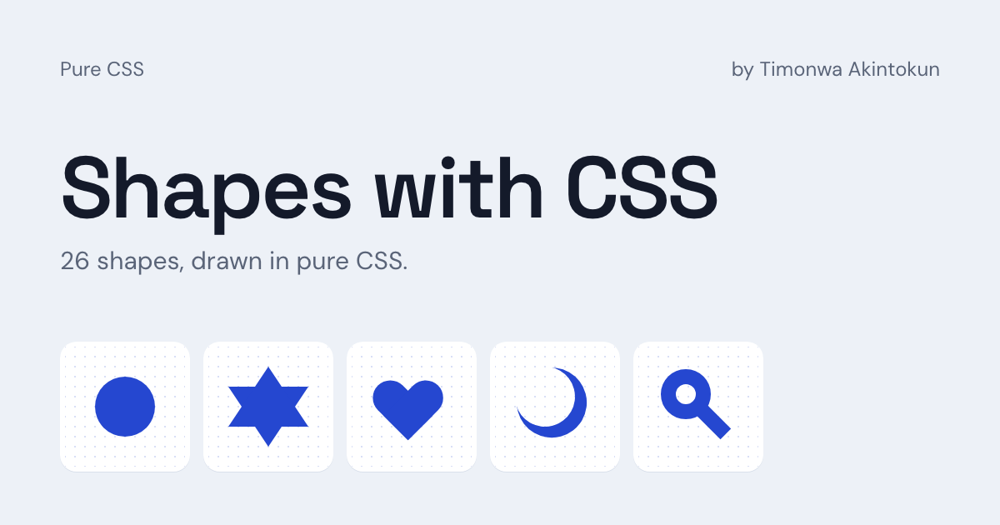

# Shapes with CSS

Twenty-six shapes, from a circle to a magnifying glass, drawn with HTML and CSS alone — no images or SVG — with the code for every shape one click away.

[](https://shapes-with-css.vercel.app) [](LICENSE)



I built this alongside [Letters with CSS](https://letters-with-css.vercel.app) to practise four CSS techniques by drawing every shape with them: pseudo-elements, borders and box-shadow, positioning, and transforms. Each shape's code can be viewed and copied, so anyone learning those techniques can see exactly how it's made.

## View and copy a shape's code

On the [live site](https://shapes-with-css.vercel.app), select any shape. A dialog shows it large, with two tabs:

- **HTML**: the markup for the shape, usually one element.
- **CSS**: every rule that draws it, plus the 240×240 box it sits in and the `--ink` colour variable.

Copy both into any page and the shape renders. Change `--ink` to recolour it. Each shape also has its own link, such as [shapes-with-css.vercel.app/#heart](https://shapes-with-css.vercel.app/#heart).

The CSS tab is read from the live stylesheet, so it always matches what's drawn.

## What's inside

- **Circles and curves:** circle, three-quarter circle, two semicircles, quarter circle, oval, egg, and pill.
- **Triangles and polygons:** equilateral, isosceles, and right triangles, square, rectangle, parallelogram, two trapezoids, rhombus, kite, pentagon, and a top-down pyramid.
- **Figures:** six-pointed star, crescent, horseshoe, plus, heart, and magnifying glass.

The two semicircles and two trapezoids are the same shape drawn two different ways, to compare techniques: `border-radius` against borders, and borders against pseudo-elements.

## What it practises

Every shape is drawn inside a 240×240 box with only these techniques:

- `::before` and `::after` pseudo-elements, for shapes built from more than one piece, like the star and heart.
- Borders and `box-shadow`: borders with transparent sides for triangles, trapezoids, and the pyramid, and `border-radius` for circles, ovals, the egg, and the pill.
- Relative and absolute positioning, to place each piece.
- Transforms, to rotate and skew pieces into place.

## Run it locally

There's no build step. Clone the repo:

```bash
git clone https://github.com/Timonwa/shapes-with-css.git
cd shapes-with-css
```

Then serve the folder, either way works:

- **VS Code:** open the folder, install the [Live Server](https://marketplace.visualstudio.com/items?itemName=ritwickdey.LiveServer) extension, and click **Go Live** in the status bar.
- **Terminal:** run `npx serve` and open the URL it prints.

Use a server rather than opening `index.html` directly: browsers block the code viewer from reading the stylesheet on `file://` pages.

## Project structure

| File | What it holds |
| --- | --- |
| `style.css` | The shapes: every rule that draws the 26 shapes |
| `site.css` | The page: layout, tiles, dialog, and colours |
| `app.js` | The code viewer: opens a shape and builds its HTML and CSS |
| `index.html` | The page markup, metadata, and the 26 shapes |
| `og.png` | The image shown when the site is shared |

## More projects like these

- [Letters with CSS](https://letters-with-css.vercel.app): the English alphabet, drawn letter by letter in pure CSS ([source](https://github.com/Timonwa/letters-with-css)).
- [JavaScript Project Series](https://javascript-project-series.vercel.app): 10+ beginner JavaScript projects, each with a step-by-step tutorial ([source](https://github.com/Timonwa/javascript-project-series)).

## License

[MIT](LICENSE) © Timonwa Akintokun
